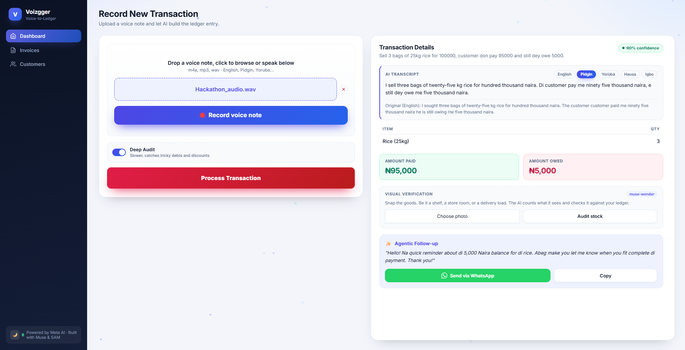
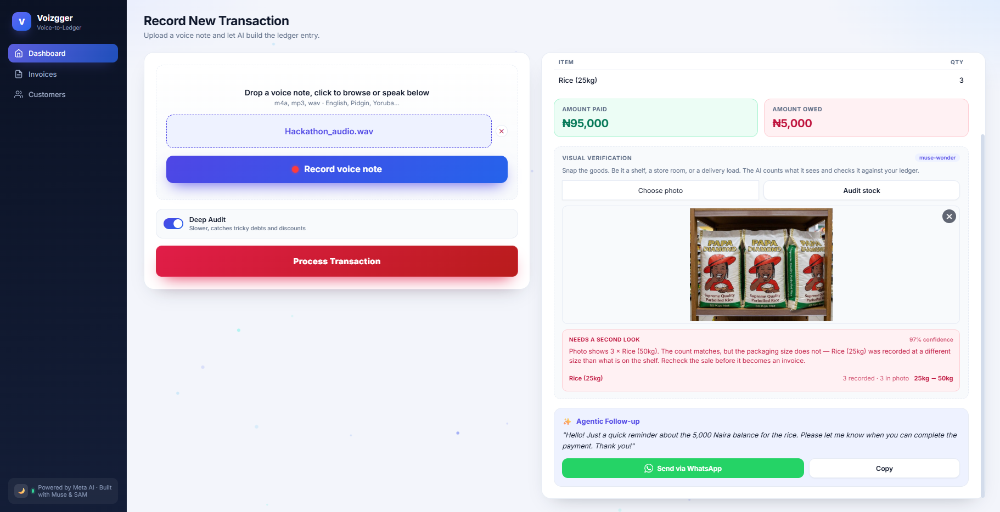
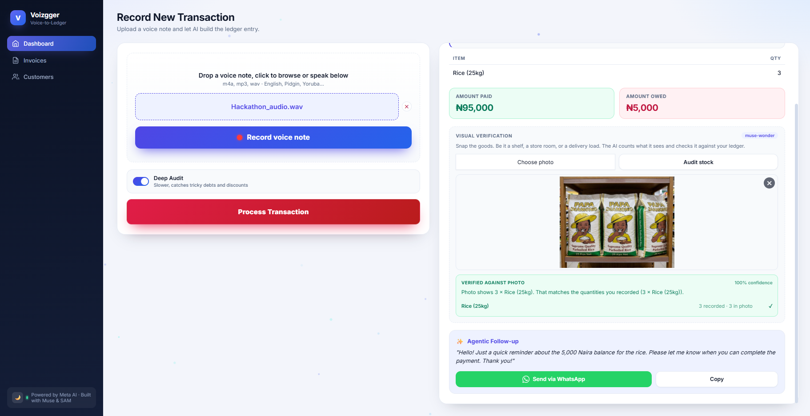
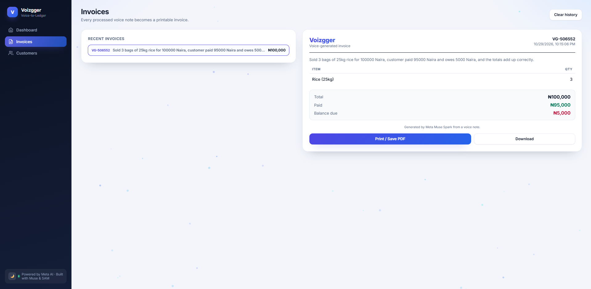

# Voizgger

**Voice-to-Ledger for the Informal Economy** - built for the Meta AI Hackathon.

> A market trader speaks: *"I sold three bags of twenty-five kilo rice for hundred thousand Naira. The customer paid me ninety-five thousand Naira - he is still owing me five thousand Naira."*
> Voizgger returns a structured ledger, a debt-tracking SMS in the customer's language, a visual audit of the shelf - and a printable invoice. In seconds.

---

## The Problem

Around **2 billion people** - roughly 60% of the world's workers - earn their living in the informal economy (ILO). In Nigeria, most market traders run the business on memory and a paper notebook:

- **No records** → no credit history → no access to loans
- **Debts tracked in the head** → forgotten, disputed, lost income
- **Paper ledgers** → destroyed by rain, fire, or a misplaced bag

Existing bookkeeping apps fail here because they demand **typing, English literacy, and smartphone fluency** from people whose workflow is *talking*.

## The Insight

Traders already narrate every transaction out loud - to customers, apprentices, themselves. Voizgger captures that narration and turns it into accounting infrastructure. **Zero typing. Zero forms. Speak, and the ledger writes itself.**

## What It Does

| Capability | How it works |
|---|---|
| 🎙️ **Voice-to-Ledger** | Record in the browser or upload a voice note in English, **Pidgin, Yorùbá, Hausa, or Igbo** - replay it in-app before processing - then **Meta Muse Voice Transcribe** turns it into items, quantities, amounts paid, and debts owed |
| 🌍 **Instant Translation** | The transcript, summary, and follow-up SMS switch between the 5 languages in one tap - the ledger stays accurate while communication stays local |
| 🧠 **Deep Audit Mode** | A `reasoning_effort` toggle escalates Muse Spark to high-effort reasoning for complex debts (conditional payments, discounts, partial settlements) |
| 🛡️ **Confidence Ledger** | Every extraction carries an AI confidence score; items below 80% are flagged amber - **the AI assists, the trader decides** |
| 📷 **Visual Stock Audit** | Snap a photo of the shelf - the vision model counts remaining stock and cross-checks it against what the voice note claims was sold, catching errors and shrinkage |
| 🧾 **Auto-Invoices** | Every voice note becomes a printable/downloadable invoice with one tap |
| 🌙 **Dark Mode** | Full light/dark themes, saved between visits |

## Design Decisions

The product is a pipeline, not a chatbot wrapper - and the shape of it comes from the user, not the tech:

1. **Voice is the whole interface** - typing, English literacy and smartphone fluency are the three things the target trader doesn't have, so none of them are required
2. **Three models, three jobs** - ASR handles Nigerian-accented, colloquial speech; high-effort reasoning untangles messy debts; the vision model audits the shelf. Each model does the part it's actually good at
3. **The AI shows its work** - every extraction carries a confidence score, and anything below 80% is flagged for the trader to confirm. The app assists; the trader decides
4. **Local languages are the product, not a feature** - a reminder SMS in the customer's own language is the difference between getting paid and getting ignored

## Architecture

```
🎙️ Voice Note (any supported language)
        │
        ▼
┌─────────────────────┐     WAV (ffmpeg, 16kHz mono)
│  Muse Voice          │ ◄──────────────────────────
│  Transcribe (ASR)    │
└─────────┬───────────┘
          │ transcript
          ▼
┌─────────────────────┐     ┌──────────────────────┐
│  Muse Spark          │ ──► │  Structured Ledger    │
│  (JSON extraction +  │     │  items · qty · paid   │
│   reasoning_effort)  │     │  owed · confidence    │
└─────────┬───────────┘     └──────────┬───────────┘
          │                            │
          ▼                            ▼
┌─────────────────────┐     ┌──────────────────────┐
│  Follow-up SMS       │     │  Printable Invoice    │
│  (in customer's      │     │  (auto-generated)     │
│   language)          │     └──────────────────────┘
└─────────────────────┘
          │
📷 Shelf Photo ──► ┌──────────────────────┐
                   │  Vision Stock Audit   │
                   │  count vs. claimed    │
                   │  sales → consistency  │
                   └──────────────────────┘
```

## Tech Stack

- **ASR** - Meta Muse Voice Transcribe (code-switching across Nigerian languages)
- **Reasoning & Extraction** - Meta Muse Spark (structured JSON, `reasoning_effort` control)
- **Visual Audit** - Meta Muse Wonder (stock counting & shelf verification)
- **Backend** - FastAPI (Python 3.10+), ffmpeg audio pipeline
- **Frontend** - Vanilla HTML/CSS/JS (no build step, runs anywhere)
- **Persistence** - SQLite for invoices (server-side, survives browser switches and cache clears); theme preference in `localStorage`

## 📸 Screenshots

### 1. Live AI Extraction & Agentic Follow-up
Spoken in Nigerian Pidgin, transcribed and structured in one pass - items, amounts, a confidence score, and a ready-to-send WhatsApp reminder in the customer's language.



### 2. Multimodal Visual Audit (Powered by Muse Wonder)

The audit doesn't just count stock - it **cross-checks what was said against what's on the shelf**. Same voice note, two photos, two different verdicts:

**2a. Discrepancy detected** - the sale was recorded as 25kg bags; the shelf holds 50kg bags. The count matches, the packaging size does not, so the audit flags it before the sale becomes an invoice.



**2b. Verified consistent** - same sale, against the shelf that actually matches the recording.



### 3. Automated Invoicing
Every processed sale becomes a printable invoice, saved server-side rather than in the browser.



## Failure Handling

Bad input never dead-ends the app and never produces an invented ledger entry. Every case below surfaces as an inline banner under **Process Transaction** (announced to screen readers via `role="alert"`):

| Trigger | What the user sees |
|---|---|
| 0-byte file | *"That file is empty. Please try another recording."* |
| Silent recording (bytes, no speech) | *"We didn't catch any speech in that recording. Check that your microphone is working, then try again."* |
| Unsupported format | *"Unsupported audio format. Please upload MP3, WAV, M4A, WEBM or OGG."* |
| Over 25 MB | *"File is too large. Please keep recordings under 25 MB."* |
| Photo with nothing recognisable | *"No goods could be recognised in this photo. Try a clearer, straight-on shot."* |
| Daily demo budget spent | *"Daily demo quota reached. Watch the demo video to see the full flow."* |

A silent recording returns *"we didn't catch any speech"* rather than a guess. Refusing to invent a transaction is the point of the trust model, not an edge case.

## Getting Started

### Prerequisites

- Python 3.10+
- **FFmpeg** on your PATH
  - Windows: [gyan.dev builds](https://www.gyan.dev/ffmpeg/builds/) → add `bin` to PATH
  - macOS: `brew install ffmpeg`
  - Linux: `sudo apt install ffmpeg`

### Setup

```bash
git clone https://github.com/Coachemmy/Voizgger.git
cd Voizgger

python -m venv .venv
# Windows PowerShell:
.\.venv\Scripts\Activate.ps1
# macOS/Linux:
source .venv/bin/activate

pip install -r requirements.txt
```

Create a `.env` file in the project root:

```env
MODEL_API_KEY=your_meta_api_key_here
```

Run:

```bash
uvicorn app.main:app --reload
```

Open **http://127.0.0.1:8000**

### Try it

Record a short voice note describing a sale (e.g. *"I sold 3 bags of rice for 20,000 Naira, the customer paid 15,000"*), upload it, and hit **Process Transaction**. Then snap a shelf photo and run the **Visual Audit**.

## Project Structure

```
app/
├── main.py              # FastAPI entry
├── api/endpoints.py     # /analyze_voice · /translate · /verify_stock · /invoices
├── core/config.py       # model & client config
├── core/db.py           # SQLite invoice persistence
└── services/meta_ai.py  # ASR → reasoning → translation → vision audit
templates/index.html     # single-page UI (Dashboard · Invoices · Customers)
static/
├── css/style.css        # design system, dark mode, print styles
└── js/app.js            # view routing, language switching, invoice store
```

### Run the tests

```bash
pip install -r requirements-dev.txt
pytest -q
```

51 tests cover the stock-matching logic (including the `"Rice (50kg)"` vs `"Rice"` normalization and packaging-size comparison), upload validation, JSON extraction, the invoice API, the daily quota and per-IP guards, and the `/health` probe.

## Deployment

The repo ships with a `Dockerfile` that installs **ffmpeg**, which the ASR pipeline needs.

```bash
docker build -t voizgger .
docker run -p 8000:8000 -e MODEL_API_KEY=your_key voizgger
```

On any container host (Render, Railway, Fly.io, Cloud Run):

1. Point it at this repo - it builds the `Dockerfile` automatically
2. Set the `MODEL_API_KEY` environment variable
3. Set `VOIZGGER_DB` to a path on persistent storage if you want invoices to survive redeploys
4. Point an uptime monitor (UptimeRobot, free tier) at `/health` - a cheap probe that touches neither the database nor the model, which keeps free-tier containers from cold-starting in front of a judge

### Cost guards

Because the API key lives server-side, it is never exposed to visitors - but a public URL still lets anyone spend your credits. Two guards bound that by default:

| Variable | Default | Purpose |
|---|---|---|
| `DEMO_DAILY_LIMIT` | `50` | AI calls per day across all visitors, then a polite 429 |
| `DEMO_IP_LIMIT` / `DEMO_IP_WINDOW` | `5` per `60`s | Stops one client flooding the endpoint |
| `DEMO_LIMITS_ENABLED` | `1` | Set to `0` for local development |

Rejected uploads (bad format, empty, oversized) never consume the daily budget - validation runs before the model does. Usage is counted in SQLite, so a restart does not reset the day's tally.

> The per-IP window is kept in memory, which is correct for a single-process deployment (Render, Fly, a single container). Running multiple workers would make each process count separately.

> **Note on persistence:** invoices are stored in SQLite. On hosts with an ephemeral filesystem (free tiers), the database resets when the container restarts. Mount a persistent disk and set `VOIZGGER_DB` to a path on it, or move to a managed Postgres for production.

## Roadmap

- [ ] **Customer CRM** - auto-built profiles, per-customer debt history, one-tap WhatsApp reminders, trust scores *(architecture ready - see the Customers tab)*
- [ ] **Offline-first PWA** - record voice notes with no connectivity, sync when back online
- [ ] **Credit scoring export** - anonymized transaction history → microloan eligibility reports for partner banks
- [ ] **Multi-user accounts** - traders + apprentices with role-based access

## Engineering Scope Note

Built under hackathon time constraints with a deliberate priority: **100% of effort on the core AI pipeline** (ASR, reasoning, visual audit) rather than breadth of CRUD screens. The data model and API surface are designed to scale into full invoicing and CRM without rework.

---

*Powered by Meta AI · Built with Muse & Vision models*
